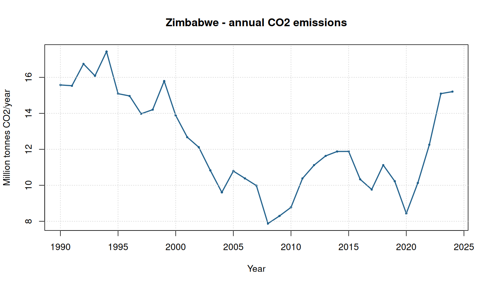

# CO₂ Emissions Analysis: Zimbabwe (ZWE)

**Student:** Adrienne Kishna Partosa Calimbo

**GitHub Username:** adriennekishna

**Country:** Zimbabwe

**ISO-3 Code:** ZWE

**Study Period:** 1990–2024

## 1. Research Question

How have annual CO₂ emissions and CO₂ emissions per capita changed in Zimbabwe from 1990 to 2024?

## 2. Data Source

This project uses data from Our World in Data (OWID), specifically the CO₂ and Greenhouse Gas Emissions dataset.

Dataset: https://github.com/owid/co2-data

The selected variables are:

- Year
- Annual CO₂ emissions
- CO₂ emissions per capita

Annual CO₂ emissions are measured in million tonnes per year, while per-capita emissions are measured in tonnes per person per year.

The analysis uses territorial CO₂ emissions from fossil fuels and industrial processes. Land-use change emissions are not included.

## 3. Software and Tools

The following tools are used:

- R
- RStudio
- Git
- GitHub

## 4. Methodology

The analysis is conducted using RStudio. The complete OWID dataset is downloaded and filtered to include only Zimbabwe using its ISO-3 country code, ZWE.

The selected data cover the period 1990–2024. The R script generates a country-specific CSV file, three graphs, summary statistics, and yearly percentage changes.

To reproduce the analysis, open the project in RStudio and run:

`source("scripts/analyze_co2.R")`

## 5. Project Files and Outputs

- `data/ZWE_co2.csv` – Zimbabwe's CO₂ emissions dataset.
- `scripts/analyze_co2.R` – R script used for the analysis.
- `figures/ZWE_annual_co2.png` – Annual CO₂ emissions graph.
- `figures/ZWE_per_capita.png` – CO₂ emissions per capita graph.
- `figures/ZWE_annual_change.png` – Annual percentage change graph.
- `results/ZWE_summary.csv` – Summary statistics.
- `results/ZWE_yearly_changes.csv` – Yearly percentage changes.
- `results/session_info.txt` – R session information.

These output files are generated when the R script is run successfully.

## 6. Graphical Results

### Annual CO₂ Emissions in Zimbabwe

### CO₂ Emissions Per Capita

### Annual Percentage Change in CO₂ Emissions

## 7. Environmental Interpretation

Our World in Data reports that Zimbabwe emitted approximately 13.7 million tonnes of territorial CO₂ in 2024, equivalent to approximately 0.82 tonnes per person. These figures provide a recent reference point for understanding Zimbabwe's emissions, but they do not by themselves describe the full trend from 1990 to 2024.

The annual emissions graph should be used to identify whether Zimbabwe's total emissions generally increased or decreased over the study period, including the highest-emission year and any notable changes. The per-capita graph provides a different perspective by showing average emissions per person rather than the country's total emissions. The annual percentage-change graph helps identify years with particularly large increases or decreases.

CO₂ emissions contribute to climate change. Changes in emissions can be associated with energy use, transportation, industrial activity, and broader economic conditions. However, this country-level analysis describes patterns and does not establish the specific causes of those changes.

The numerical trend, peak year, and percentage change for 1990–2024 should be interpreted using the generated `ZWE_summary.csv`, `ZWE_yearly_changes.csv`, and graphs. This avoids drawing conclusions from unverified or incomplete values.

## 8. Limitations

The dataset focuses on territorial CO₂ emissions from fossil fuels and industrial processes. It does not represent all greenhouse gases and does not include land-use change emissions. Missing values are not treated as zero. National-level data may also hide differences between regions and industries within Zimbabwe. Observed patterns do not establish causation. The dataset may be updated by OWID, so results can differ depending on the download date.

## 9. References

- Our World in Data. CO₂ and Greenhouse Gas Emissions Dataset. https://github.com/owid/co2-data
- Our World in Data. CO₂ emissions data and methodology. https://ourworldindata.org/co2-emissions
- Our World in Data. CO₂ and Greenhouse Gas Emissions: Zimbabwe country profile. https://ourworldindata.org/profile/co2/zimbabwe
