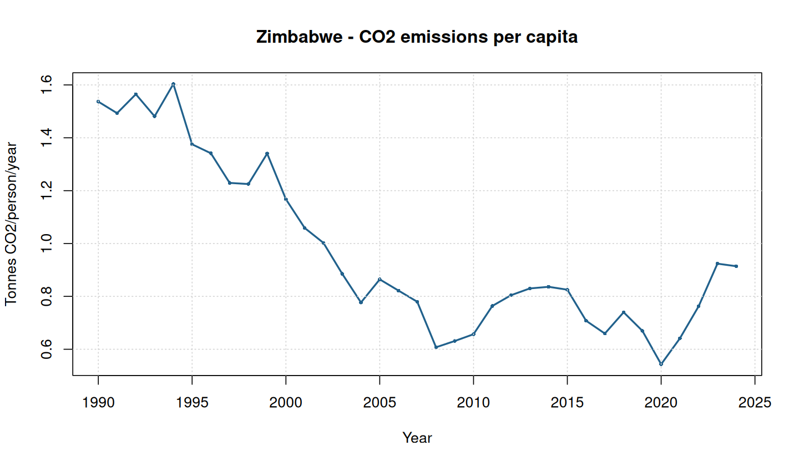
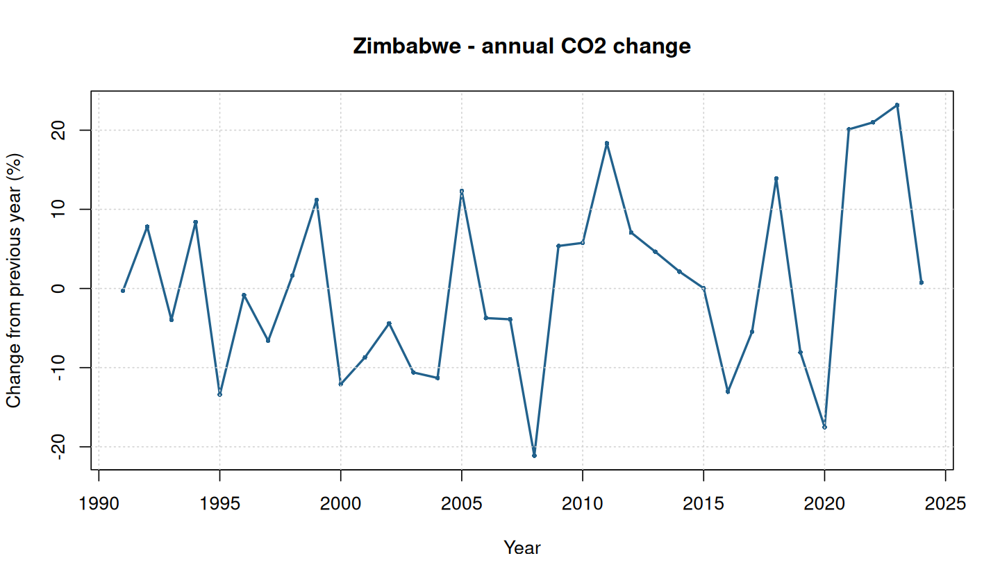

# CO₂ Emissions Analysis: Zimbabwe (ZWE)

**Student:** Adrienne Kishna Partosa Calimbo  
**GitHub Username:** adriennekishna  
**Country:** Zimbabwe  
**ISO-3 Code:** ZWE  
**Study Period:** 1990–2024

## 1. Research Question

How have annual CO₂ emissions and CO₂ emissions per capita changed in Zimbabwe from 1990 to 2024?

## 2. Data Source

This project uses the Our World in Data (OWID) CO₂ and Greenhouse Gas Emissions dataset.

Dataset: https://github.com/owid/co2-data

The selected variables are year, annual CO₂ emissions, and CO₂ emissions per capita. Annual emissions are measured in million tonnes of CO₂ per year; per-capita emissions are measured in tonnes per person per year.

The analysis uses territorial CO₂ emissions from fossil fuels and industrial processes. Land-use change emissions are not included.

## 3. Software and Tools

- R
- RStudio
- Git
- GitHub

## 4. Methodology

The OWID dataset is downloaded and filtered for Zimbabwe using ISO-3 code `ZWE`. The analysis covers 1990–2024. The R script exports a country-specific CSV, three graphs, summary statistics, yearly percentage changes, and R session information.

To reproduce the analysis, open the repository root in RStudio and run:

```r
source("scripts/analyze_co2.R")
```

## 5. Project Files and Outputs

- `data/ZWE_co2.csv` – Zimbabwe's country-specific CO₂ dataset.
- `scripts/analyze_co2.R` – R script used for the analysis.
- `figures/ZWE_annual_co2.png` – Annual CO₂ emissions graph.
- `figures/ZWE_per_capita.png` – CO₂ emissions per capita graph.
- `figures/ZWE_annual_change.png` – Annual percentage change graph.
- `results/ZWE_summary.csv` – Summary statistics.
- `results/ZWE_yearly_changes.csv` – Yearly CO₂ values and percentage changes.
- `results/session_info.txt` – Data source, processing timestamp, and R session information.

The generated data, figures, and result files from this run are included in the repository.

## 6. Graphical Results

### Annual CO₂ Emissions in Zimbabwe


### CO₂ Emissions Per Capita



### Annual Percentage Change in CO₂ Emissions



## 7. Environmental Interpretation

The analyzed OWID extract shows that Zimbabwe's territorial CO₂ emissions were **15.58 million tonnes in 1990** and **15.21 million tonnes in 2024**, a net change of approximately **−2.38%** between those endpoints. Within the study period, the highest annual value in the extract was **17.44 million tonnes in 1994**. The latest per-capita value in the extract was approximately **0.91 tonnes per person in 2024**, compared with approximately **1.54 tonnes per person in 1990**.

The annual emissions graph describes total national emissions, while the per-capita graph adjusts the perspective for population size. The yearly percentage-change graph highlights short-term rises and falls; for example, the largest positive year-over-year change in the included series was approximately **23.17% in 2023**, while the largest decline was approximately **−21.13% in 2008**.

These figures describe observed patterns in the selected dataset. They do not, on their own, establish why emissions changed. Possible influences such as energy use, transport, industrial activity, and economic conditions would require separate evidence to assess.

## 8. Limitations

The dataset focuses on territorial CO₂ emissions from fossil fuels and industrial processes. It does not represent all greenhouse gases and does not include land-use change emissions. Missing values are not treated as zero. National-level data may hide differences between regions and industries within Zimbabwe. Observed patterns do not establish causation. OWID may update its dataset, so rerunning the script later can produce revised values.

## 9. References

- Our World in Data. *CO₂ and Greenhouse Gas Emissions Dataset*. https://github.com/owid/co2-data
- Our World in Data. *CO₂ emissions data and methodology*. https://ourworldindata.org/co2-emissions
- Our World in Data. *CO₂ and Greenhouse Gas Emissions: Zimbabwe country profile*. https://ourworldindata.org/profile/co2/zimbabwe
